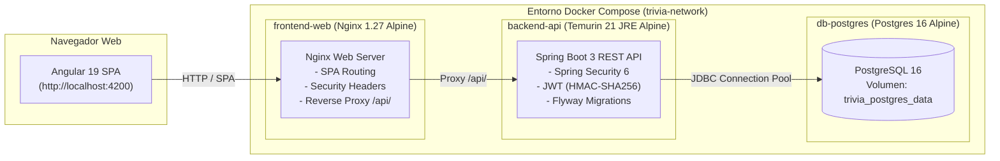

# 🧠 Trivia Platform - Aplicación Multijugador Individual

Plataforma interactiva de preguntas y respuestas estructurada en arquitectura moderna desacoplada: **Spring Boot 3 (Java 21)** en backend, **Angular 19** con Standalone Components y Tailwind CSS en frontend, y **PostgreSQL 16** con migraciones automatizadas vía **Flyway**.

---

## 🏗️ Arquitectura del Sistema



---

## 🚀 Despliegue Rápido con Docker

### Prerrequisitos
- [Docker Desktop](https://www.docker.com/products/docker-desktop/) (v24+ recomendado) con Docker Compose v2.

### 1. Clonar el repositorio y configurar variables de entorno
Asegúrate de contar con el archivo de variables locales `.env`. Puedes copiarlo desde el template:

```bash
cp .env.example .env
```

> **Nota DevSecOps:** El archivo `.env` ya viene precargado con una clave secreta JWT criptográfica de 256 bits y credenciales predeterminadas seguras para desarrollo. No commitees `.env` a repositorios públicos.

### 2. Construcción y levantamiento de contenedores

Ejecuta en la raíz del proyecto:

```bash
docker compose up --build -d
```

Docker construirá de forma multi-stage las imágenes optimizadas para el backend y el frontend, inicializará PostgreSQL con su healthcheck y levantará la red privada `trivia-network`.

### 3. Verificar estado de los servicios

```bash
docker compose ps
```

Salida esperada:
- `trivia-postgres`: Estado `healthy` en puerto `0.0.0.0:5432->5432/tcp`.
- `trivia-backend-api`: Estado `running` en puerto `0.0.0.0:8080->8080/tcp`.
- `trivia-frontend-web`: Estado `running` en puertos `0.0.0.0:4200->80/tcp` y `0.0.0.0:80->80/tcp`.

### 4. Monitoreo de logs

```bash
# Ver logs de todos los servicios
docker compose logs -f

# Ver logs específicos del backend
docker compose logs -f backend-api
```

### 5. Detención de la plataforma

```bash
# Detener contenedores manteniendo datos de la BD
docker compose down

# Detener contenedores eliminando volúmenes (reset total)
docker compose down -v
```

---

## 🌐 URLs de Acceso Local

| Servicio | URL Local | Descripción |
| :--- | :--- | :--- |
| **Frontend Web SPA** | [http://localhost:4200](http://localhost:4200) *(o [http://localhost](http://localhost))* | Aplicación cliente Angular 19 (con proxy inverso `/api` al backend) |
| **Backend REST API** | [http://localhost:8081/api](http://localhost:8081/api) *(o [http://localhost:4200/api](http://localhost:4200/api))* | API Base de servicios REST |
| **Swagger / OpenAPI** | [http://localhost:8081/swagger-ui.html](http://localhost:8081/swagger-ui.html) | Documentación interactiva de endpoints |
| **Healthcheck API** | [http://localhost:8081/actuator/health](http://localhost:8081/actuator/health) | Diagnóstico y monitoreo de estado del backend |
| **Base de Datos PostgreSQL** | `localhost:5432` | Base de datos `trivia_db` (Usuario: `postgres`) |

---

## 🔑 Credenciales de Prueba Disponibles

El sistema incluye usuarios de prueba presembrados en la base de datos mediante migraciones de Flyway:

| Usuario (`username`) | Correo (`email`) | Contraseña | Rol | Acceso |
| :--- | :--- | :--- | :--- | :--- |
| `admin` | `admin@trivia.com` | `Password123` *(o `Password123!`)* | `ROLE_ADMIN` | Gestión total, banco de preguntas y analíticas |
| `jugador1` | `jugador1@trivia.com` | `Password123` *(o `Password123!`)* | `ROLE_PLAYER` | Juego individual, historial y clasificación global |

> **Nota de Seguridad:** Las contraseñas se encuentran almacenadas mediante hashes criptográficos **BCrypt** de costo 10 (`$2a$10$...`).

---

## 🧪 Ejecución de Suites de Pruebas

### Pruebas de Backend (Spring Boot & JUnit 5)

Requiere Java 21 y Maven (o utilizar el wrapper incluido):

```bash
cd backend

# Ejecutar pruebas unitarias y de integración
./mvnw clean test

# En Windows PowerShell
.\mvnw.cmd clean test
```

### Pruebas de Frontend (Angular & Playwright E2E)

Requiere Node.js 20+ y dependencias instaladas:

```bash
cd frontend

# Instalar dependencias locales
npm install

# 1. Pruebas Unitarias de Componentes y Servicios (Karma / Jasmine)
npm test -- --watch=false --browsers=ChromeHeadless

# 2. Pruebas End-to-End (E2E) con Playwright
npx playwright install --with-deps
npm run test:e2e
```

---

## 🛡️ Auditoría y Resumen de Medidas DevSecOps

1. **Gestión Segura de Credenciales:**
   - Cero secretos o contraseñas en código fuente.
   - Todo parámetro sensible reside en `.env` (ignorado en `.gitignore`).
   - Secretos de firma JWT generados con entropía criptográfica de 256 bits (HMAC-SHA256).

2. **Seguridad en Contenedores (Container Hardening):**
   - **Backend:** Compilación multi-stage en `maven:3.9.9-alpine` y ejecución en `eclipse-temurin:21-jre-alpine` con usuario sin privilegios root (`spring:spring`).
   - **Frontend:** Compilación multi-stage en `node:22-alpine` y servidor `nginx:1.27-alpine` con headers de seguridad (`X-Frame-Options: DENY`, `X-Content-Type-Options: nosniff`, `Content-Security-Policy`).
   - **PostgreSQL:** Red dedicada `trivia-network` con persistencia en volumen nominal y healthchecks automáticos con `pg_isready`.

3. **Autenticación y Autorización Estricta:**
   - Endpoints de autenticación (`/api/v1/auth/**`) y consulta de categorías públicas.
   - Endpoints de partidas (`/api/v1/games/**`), envío de respuestas y rankings exigen token Bearer JWT válido.
   - Respuestas de error estandarizadas bajo RFC 7807 (Problem Details).
