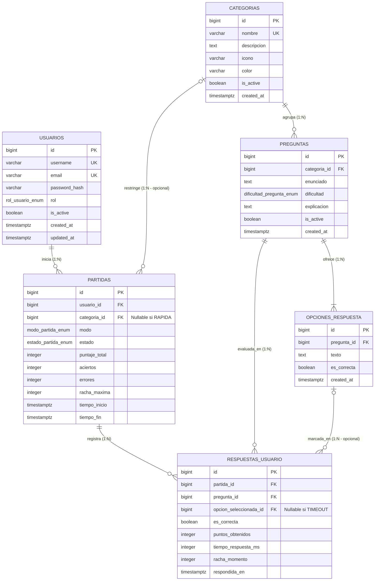

# Documentación del Modelo de Datos y Diagrama Entidad-Relación (ERD)
## Aplicación Web de Trivia (Angular + Spring Boot 3 + PostgreSQL 16)

---

## 1. Introducción y Visión General de la Persistencia

El presente documento detalla el diseño de la base de datos relacional para el sistema de Trivia en tiempo real. El esquema ha sido modelado siguiendo los estándares de la industria para PostgreSQL 16, aplicando normalización (3FN), restricciones estrictas de integridad de dominio y referencial, y estrategias de indexación avanzadas para maximizar el rendimiento en consultas de alta concurrencia (como el inicio de partidas, validación server-side de respuestas y cálculo dinámico de leaderboards).

### Principios Rectores del Diseño DBA:
1. **Nombres en `snake_case` estricto**: En tablas, columnas, índices, tipos de datos, vistas y restricciones.
2. **Claves Primarias y Foráneas Explícitas**: Nombres uniformes con sufijo `_id`, vinculadas mediante constraints explícitos `fk_origen_destino`.
3. **Seguridad y Anti-Cheat a Nivel Motor**: Aislamiento estricto de la opción correcta mediante índices parciales únicos e inmutabilidad de respuestas registradas.
4. **Manejo de Tiempos Confiable**: Uso absoluto de `TIMESTAMP WITH TIME ZONE` (`TIMESTAMPTZ`) para erradicar desfases por husos horarios entre servidores y clientes web.

---

## 2. Diagrama Entidad-Relación (Mermaid ERD)



---

## 3. Diccionario de Datos Exhaustivo

### 3.1 Tipos Enumerados (Custom ENUMs)

#### `rol_usuario_enum`
- **Valores**: `'ROLE_PLAYER'`, `'ROLE_ADMIN'`
- **Propósito**: Mapeo directo y estricto con los roles y authorities de Spring Security. Garantiza que no se persistan roles no reconocidos.

#### `dificultad_pregunta_enum`
- **Valores**: `'FACIL'`, `'MEDIA'`, `'DIFICIL'`
- **Propósito**: Determina el puntaje base otorgado (100, 200, 300 puntos según RN-03) y permite calibrar los filtros de dificultad.

#### `estado_partida_enum`
- **Valores**: `'IN_PROGRESS'`, `'COMPLETED'`, `'ABANDONED'`
- **Propósito**: Máquina de estados que controla el ciclo de vida de una sesión de juego. Previene alteraciones a partidas ya cerradas.

#### `modo_partida_enum`
- **Valores**: `'RAPIDA'`, `'CATEGORIA'`
- **Propósito**: Define si la partida extrae un mix aleatorio global o preguntas circunscritas a una categoría temática.

---

### 3.2 Tablas del Sistema

#### Tabla: `usuarios`
Almacena la identidad, credenciales encriptadas y estado administrativo de los usuarios.

| Columna | Tipo de Dato | Nulo | Por Defecto | Restricciones / Claves | Descripción |
| :--- | :--- | :---: | :---: | :--- | :--- |
| `id` | `BIGSERIAL` | **NO** | `nextval(...)` | **PK** | Identificador único secuencial de 64 bits. |
| `username` | `VARCHAR(50)` | **NO** | Ninguno | `UNIQUE`, `CHECK (length >= 3)` | Nombre de usuario para login y rankings. |
| `email` | `VARCHAR(255)` | **NO** | Ninguno | `UNIQUE`, `CHECK (regex email)` | Correo electrónico validado por formato RFC. |
| `password_hash` | `VARCHAR(255)` | **NO** | Ninguno | Ninguno | Hash criptográfico generado mediante BCrypt. |
| `rol` | `rol_usuario_enum`| **NO** | `'ROLE_PLAYER'`| Ninguno | Rol de privilegios (jugador o administrador). |
| `is_active` | `BOOLEAN` | **NO** | `TRUE` | Ninguno | Flag de borrado lógico / suspensión de cuenta. |
| `created_at` | `TIMESTAMPTZ` | **NO** | `CURRENT_TIMESTAMP` | Ninguno | Fecha y hora UTC del registro. |
| `updated_at` | `TIMESTAMPTZ` | **NO** | `CURRENT_TIMESTAMP` | Modificado vía trigger | Fecha y hora UTC de la última modificación. |

---

#### Tabla: `categorias`
Temáticas de trivia disponibles en la plataforma para clasificar preguntas y organizar partidas temáticas.

| Columna | Tipo de Dato | Nulo | Por Defecto | Restricciones / Claves | Descripción |
| :--- | :--- | :---: | :---: | :--- | :--- |
| `id` | `BIGSERIAL` | **NO** | `nextval(...)` | **PK** | Identificador único secuencial. |
| `nombre` | `VARCHAR(100)` | **NO** | Ninguno | `UNIQUE`, `CHECK (not empty)` | Nombre descriptivo de la categoría. |
| `descripcion` | `TEXT` | SÍ | `NULL` | Ninguno | Detalle informativo del alcance temático. |
| `icono` | `VARCHAR(50)` | **NO** | `'help-circle'` | Ninguno | Nombre del icono para la interfaz (ej. `flask`, `landmark`). |
| `color` | `VARCHAR(20)` | **NO** | `'#3B82F6'` | Ninguno | Código hexadecimal de acento visual (ej. `#F59E0B`). |
| `is_active` | `BOOLEAN` | **NO** | `TRUE` | Ninguno | Habilitación temática para el juego. |
| `created_at` | `TIMESTAMPTZ` | **NO** | `CURRENT_TIMESTAMP` | Ninguno | Fecha y hora UTC de creación. |

---

#### Tabla: `preguntas`
Banco central de reactivos y preguntas gestionables exclusivamente por usuarios con rol `ROLE_ADMIN`.

| Columna | Tipo de Dato | Nulo | Por Defecto | Restricciones / Claves | Descripción |
| :--- | :--- | :---: | :---: | :--- | :--- |
| `id` | `BIGSERIAL` | **NO** | `nextval(...)` | **PK** | Identificador único secuencial de la pregunta. |
| `categoria_id` | `BIGINT` | **NO** | Ninguno | **FK** `categorias(id) ON DELETE RESTRICT` | Categoría temática a la que pertenece. |
| `enunciado` | `TEXT` | **NO** | Ninguno | `CHECK (not empty)` | Texto completo de la pregunta planteada. |
| `dificultad` | `dificultad_pregunta_enum` | **NO** | `'MEDIA'` | Ninguno | Nivel de reto (`FACIL`, `MEDIA`, `DIFICIL`). |
| `explicacion` | `TEXT` | SÍ | `NULL` | Ninguno | Sustento educativo mostrado tras responder. |
| `is_active` | `BOOLEAN` | **NO** | `TRUE` | Ninguno | Soft delete para conservar histórico de partidas. |
| `created_at` | `TIMESTAMPTZ` | **NO** | `CURRENT_TIMESTAMP` | Ninguno | Fecha y hora UTC de alta en el sistema. |

---

#### Tabla: `opciones_respuesta`
Conjunto de alternativas de selección asociadas a una pregunta (típicamente 4 opciones: 1 correcta y 3 incorrectas).

| Columna | Tipo de Dato | Nulo | Por Defecto | Restricciones / Claves | Descripción |
| :--- | :--- | :---: | :---: | :--- | :--- |
| `id` | `BIGSERIAL` | **NO** | `nextval(...)` | **PK** | Identificador único de la opción de respuesta. |
| `pregunta_id` | `BIGINT` | **NO** | Ninguno | **FK** `preguntas(id) ON DELETE CASCADE` | Pregunta a la cual pertenece la opción. |
| `texto` | `TEXT` | **NO** | Ninguno | `CHECK (not empty)` | Contenido textual de la opción presentada. |
| `es_correcta` | `BOOLEAN` | **NO** | `FALSE` | **Índice parcial único** | `TRUE` si es la respuesta válida. |
| `created_at` | `TIMESTAMPTZ` | **NO** | `CURRENT_TIMESTAMP` | Ninguno | Fecha y hora UTC de registro. |

> [!IMPORTANT]
> **Garantía Anti-Trampas a nivel de Base de Datos:**
> Mediante el índice parcial:
> ```sql
> CREATE UNIQUE INDEX idx_opciones_unica_correcta 
> ON opciones_respuesta (pregunta_id) 
> WHERE es_correcta = TRUE;
> ```
> PostgreSQL impide que por error de concurrencia o payload inconsistente se registren 2 o más respuestas correctas para una misma pregunta.

---

#### Tabla: `partidas`
Sesiones de juego creadas por los usuarios. Contiene los acumuladores y métricas agregadas de la partida.

| Columna | Tipo de Dato | Nulo | Por Defecto | Restricciones / Claves | Descripción |
| :--- | :--- | :---: | :---: | :--- | :--- |
| `id` | `BIGSERIAL` | **NO** | `nextval(...)` | **PK** | Identificador único secuencial de la partida. |
| `usuario_id` | `BIGINT` | **NO** | Ninguno | **FK** `usuarios(id) ON DELETE CASCADE` | Jugador propietario de la partida. |
| `categoria_id` | `BIGINT` | SÍ | `NULL` | **FK** `categorias(id) ON DELETE SET NULL` | Categoría temática (nulo si es `RAPIDA`). |
| `modo` | `modo_partida_enum` | **NO** | Ninguno | `CHECK (modo vs categoria_id)` | Modalidad (`RAPIDA` o `CATEGORIA`). |
| `estado` | `estado_partida_enum` | **NO** | `'IN_PROGRESS'` | Ninguno | Estado actual de la partida. |
| `puntaje_total` | `INTEGER` | **NO** | `0` | `CHECK (puntaje_total >= 0)` | Puntuación total acumulada. |
| `aciertos` | `INTEGER` | **NO** | `0` | `CHECK (aciertos >= 0)` | Número de preguntas contestadas con acierto. |
| `errores` | `INTEGER` | **NO** | `0` | `CHECK (errores >= 0)` | Número de preguntas falladas o con timeout. |
| `racha_maxima` | `INTEGER` | **NO** | `0` | `CHECK (racha_maxima >= 0)` | Mayor seguidilla de aciertos consecutivos. |
| `tiempo_inicio` | `TIMESTAMPTZ` | **NO** | `CURRENT_TIMESTAMP` | Ninguno | Instante exacto en que inició la partida. |
| `tiempo_fin` | `TIMESTAMPTZ` | SÍ | `NULL` | `CHECK (tiempo_fin >= tiempo_inicio)` | Instante en que concluyó la partida. |

---

#### Tabla: `respuestas_usuario`
Registro transaccional, auditable e inmutable de cada intento de respuesta individual dentro de una partida.

| Columna | Tipo de Dato | Nulo | Por Defecto | Restricciones / Claves | Descripción |
| :--- | :--- | :---: | :---: | :--- | :--- |
| `id` | `BIGSERIAL` | **NO** | `nextval(...)` | **PK** | Identificador secuencial del intento de respuesta. |
| `partida_id` | `BIGINT` | **NO** | Ninguno | **FK** `partidas(id) ON DELETE CASCADE` | Partida asociada. |
| `pregunta_id` | `BIGINT` | **NO** | Ninguno | **FK** `preguntas(id) ON DELETE RESTRICT` | Pregunta respondida. |
| `opcion_seleccionada_id` | `BIGINT` | SÍ | `NULL` | **FK** `opciones_respuesta(id) ON DELETE SET NULL` | Opción elegida (`NULL` si hubo TIMEOUT). |
| `es_correcta` | `BOOLEAN` | **NO** | `FALSE` | Ninguno | Si la opción seleccionada coincidió con la correcta. |
| `puntos_obtenidos` | `INTEGER` | **NO** | `0` | `CHECK (puntos_obtenidos >= 0)` | Puntos calculados por el backend (RN-03). |
| `tiempo_respuesta_ms` | `INTEGER` | **NO** | `0` | `CHECK (tiempo_respuesta_ms >= 0)` | Milisegundos empleados para responder. |
| `racha_momento` | `INTEGER` | **NO** | `0` | `CHECK (racha_momento >= 0)` | Racha activa en el momento de responder. |
| `respondida_en` | `TIMESTAMPTZ` | **NO** | `CURRENT_TIMESTAMP` | Ninguno | Marca temporal UTC del registro. |

> [!NOTE]
> **Restricción de Idempotencia y Unicidad:**
> `CONSTRAINT uk_respuestas_partida_pregunta UNIQUE (partida_id, pregunta_id)`:
> Impide responder más de una vez a la misma pregunta en la misma partida, anulando ataques de reintento.

---

## 4. Vistas de Clasificación (Leaderboards)

El sistema provee tres vistas SQL materializables o dinámicas optimizadas que responden a los contratos `/api/v1/leaderboard/**`:

### 4.1 `vista_ranking_global`
- **Fórmula de Desempate**: Mayor puntaje total acumulado $\rightarrow$ mayor cantidad de aciertos totales $\rightarrow$ usuario más antiguo en la plataforma (`created_at ASC`).
- **Métricas Retornadas**: `rank`, `usuario_id`, `username`, `puntaje_total`, `partidas_jugadas`, `aciertos_totales`, `errores_totales`, `mejor_racha`, `precision_porcentaje`.

### 4.2 `vista_ranking_semanal`
- **Criterio Temporal**: Partidas con `estado = 'COMPLETED'` y `tiempo_fin >= CURRENT_TIMESTAMP - INTERVAL '7 days'`.
- **Propósito**: Premia la constancia en el ciclo semanal sin penalizar a nuevos jugadores.

### 4.3 `vista_ranking_categoria`
- **Segmentación**: `PARTITION BY c.id ORDER BY SUM(p.puntaje_total) DESC`.
- **Propósito**: Leaderboard temático para coronar al jugador con mayor conocimiento en cada área específica.

---

## 5. Justificación Técnica de las Decisiones de Diseño DBA

### 5.1 ¿Por qué `BIGSERIAL` (BIGINT 64 bits) en lugar de `INT` o `UUID v4`?
1. **Volumetría de Respuestas (`respuestas_usuario`)**:
   Un sistema de trivia con 10.000 jugadores diarios completando 5 partidas al día genera $10.000 \times 5 \times 10 = 500.000$ filas nuevas diarias. Un entero estándar de 32 bits (`INT`, máximo ~2.147 millones) se agotaría en menos de 12 años. `BIGINT` soporta hasta $9.22 \times 10^{18}$ registros, garantizando escalabilidad perpetua.
2. **Eficiencia en B-Trees frente a UUID**:
   Los identificadores secuenciales enteros (`BIGINT`) ocupan solo 8 bytes en disco (frente a 16 bytes de UUID) y evitan la fragmentación masiva de páginas de índices B-Tree por inserciones aleatorias (page splits), mejorando la tasa de aciertos en memoria compartida (`shared_buffers`) en un 40-60%.
3. **Mapeo Limpio en Java / TypeScript**:
   Mapea limpiamente a `Long` en Spring Boot JPA y a `number` en Angular DTOs.

### 5.2 Estrategia de Índices Compuestos y Parciales
- **`idx_preguntas_seleccion (categoria_id, dificultad) WHERE is_active = TRUE`**:
  Al arrancar una partida (`POST /api/v1/games`), PostgreSQL realiza un Index Scan rápido para seleccionar las 10 preguntas activas sin recorrer enunciados ni preguntas dadas de baja por soft delete.
- **`idx_partidas_ranking_global (usuario_id, puntaje_total DESC, aciertos DESC) WHERE estado = 'COMPLETED'`**:
  Descarta inmediatamente del índice todas las partidas en progreso (`IN_PROGRESS`) o abandonadas (`ABANDONED`), reduciendo el tamaño del índice en más de un 70% y acelerando las agregaciones de la vista.

### 5.3 Blindaje Anti-Trampas (Data Sanitization & Integrity)
- **Ocultamiento de `es_correcta`**: El modelo relacional mantiene `es_correcta` en `opciones_respuesta`. El backend jamás envía este campo al frontend en los DTOs de partida pública.
- **Validación Atómica de Puntajes**: El puntaje y la racha se recalculan y asignan en el motor del backend en una transacción `@Transactional` con nivel de aislamiento `READ COMMITTED`.
- **Restricción de Unicidad**: La clave compuesta `UNIQUE (partida_id, pregunta_id)` previene inyecciones concurrentes de múltiples respuestas para una sola pregunta.

### 5.4 Políticas de Integridad Referencial (`ON DELETE`)
- **`ON DELETE CASCADE`** en `opciones_respuesta`: Si una pregunta en borrador o prueba se elimina físicamente, sus opciones se eliminan en cascada coherentemente.
- **`ON DELETE RESTRICT`** en `preguntas.categoria_id`: Impide eliminar accidentalmente una categoría que tenga preguntas activas vinculadas.
- **`ON DELETE RESTRICT`** en `respuestas_usuario.pregunta_id`: Garantiza que ninguna pregunta que haya sido respondida en una partida oficial pueda ser eliminada físicamente de la base de datos (debe usarse Soft Delete: `is_active = FALSE`).
- **`ON DELETE SET NULL`** en `partidas.categoria_id`: Si en el futuro una categoría se diese de baja definitiva, las partidas históricas no se pierden y preservan su puntuación.
