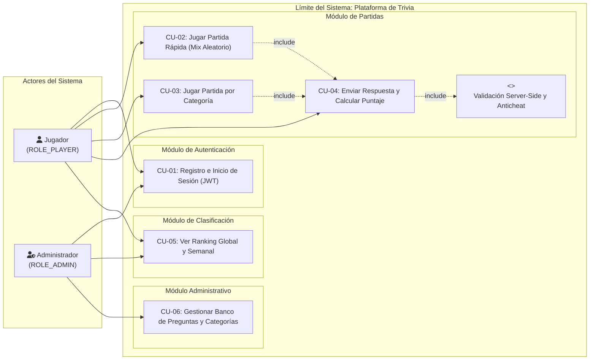
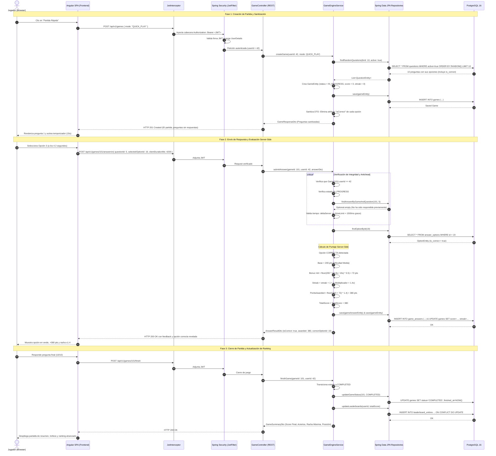
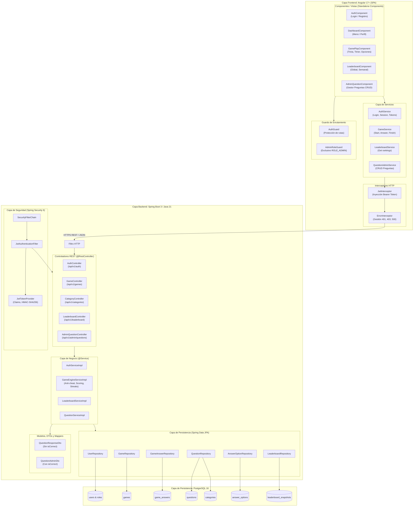
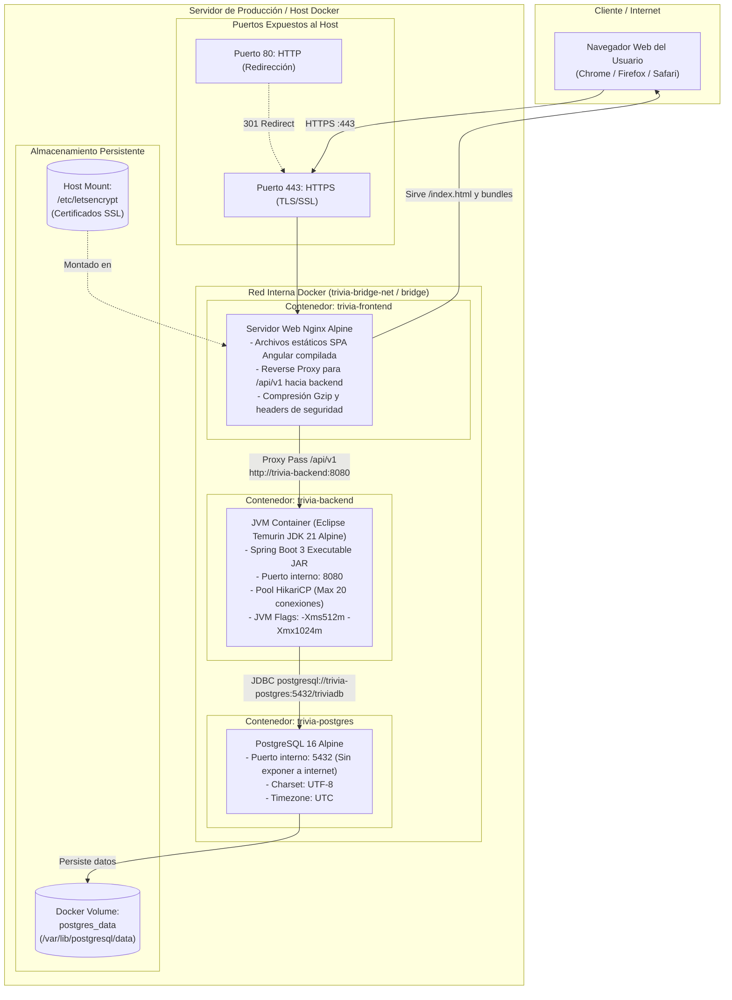

# Diagramas de Arquitectura
## Sistema de Trivia Multijugador Individual (Angular + Spring Boot + PostgreSQL)

---

## 1. Diagrama de Casos de Uso

El siguiente diagrama modela las interacciones entre los actores del sistema y los casos de uso definidos para la plataforma.

---

## 2. Diagrama de Secuencia: Flujo Completo de Partida

Este diagrama detalla la interacción paso a paso entre la SPA Angular, los filtros de seguridad, el controlador REST, el motor de juego en Spring Boot y PostgreSQL. Se ilustra la entrega de preguntas **sanitizadas** (sin opciones correctas), el envío de respuestas con validación temporal estricta y el cálculo de puntaje server-side.

---

## 3. Diagrama de Componentes (Arquitectura en Capas)

El siguiente diagrama ilustra la arquitectura de software por capas y la separación de responsabilidades entre el cliente Angular, el backend Spring Boot y la base de datos PostgreSQL.

---

## 4. Diagrama de Despliegue (Infraestructura de Contenedores Docker)

El siguiente diagrama describe la topología de contenedores desplegada mediante Docker Compose, aislamiento de redes, volúmenes de almacenamiento persistente y exposición de puertos.

