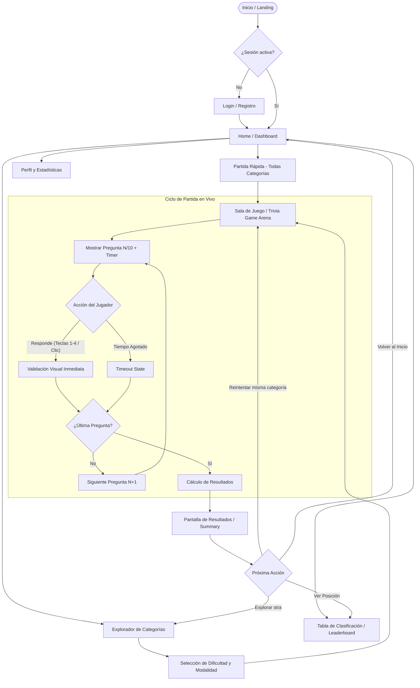

# Flujos de Navegación, Wireframes y Componentes Angular

> **Aplicación:** Trivia Web App (Angular + Spring Boot + PostgreSQL)  
> **Ubicación:** `docs/ux-ui/flujos-y-componentes.md`  
> **Versión:** 1.0.0  
> **Rol:** Arquitectura UX/UI Frontend

---

## 1. Flujo de Navegación del Usuario (User Journey)

El flujo está optimizado para minimizar la fricción entre la autenticación y el primer acierto de juego, asegurando un ciclo adictivo de "Jugar -> Ver Resultados -> Reintentar o Subir de Rango".

### 1.1 Diagrama de Flujo (Mermaid)



### 1.2 Descripción Paso a Paso

1. **Autenticación (Login / Registro):** Acceso rápido con correo/contraseña o inicio como invitado (*Guest Mode*).
2. **Dashboard / Home:** Vista general con estadísticas personales (puntos totales, ratio de acierto, nivel), botón prominente "Partida Rápida" y carrusel/rejilla de categorías temáticas.
3. **Selección de Categoría y Dificultad:** El usuario elige su área de conocimiento (Ciencia, Historia, Cine, Deportes, etc.) y nivel (Fácil, Medio, Difícil).
4. **Game Arena (Sala de Juego):** 10 preguntas cronometradas (15 segundos por pregunta). Feedback audiovisual tras cada selección con preservación de racha.
5. **Resultados (Summary Screen):** Resumen analítico del rendimiento: XP acumulada, multiplicadores por velocidad y racha, medallas desbloqueadas y botón para compartir puntuación.
6. **Leaderboard:** Ranking interactivo con filtros temporal (Semanal / Histórico) y por categoría con podio destacado.

---

## 2. Wireframes Estructurales (ASCII Art)

---

### Wireframe 1: Pantalla de Inicio / Dashboard y Selector de Categorías

```
+-----------------------------------------------------------------------------------------+
| [⚡ TRIVIA ARENA]         [Buscar...]          (🔥 5 Dias)  (1,450 XP)  [👤 Carlos ▼]  |
+-----------------------------------------------------------------------------------------+
|                                                                                         |
|  +-----------------------------------------------------------------------------------+  |
|  |  BANNER HERO: ¡TEMPORADA 3 ACTIVA!                                                |  |
|  |  Desafía tu mente, escala en la tabla global y desbloquea insignias exclusivas.   |  |
|  |                                                                                   |  |
|  |  [ ▶ PARTIDA RÁPIDA (Aleatoria) ]       [ 🏆 VER RANKING SEMANAL ]                |  |
|  +-----------------------------------------------------------------------------------+  |
|                                                                                         |
|  MIS ESTADÍSTICAS RÁPIDAS                                                               |
|  +-------------------+  +-------------------+  +-------------------+  +---------------+  |
|  | 🎮 Partidas: 142   |  | 🎯 Precisión: 78% |  | 🔥 Mejor Racha: 9 |  | 🏅 Rango: Oro |  |
|  +-------------------+  +-------------------+  +-------------------+  +---------------+  |
|                                                                                         |
|  EXPLORA POR CATEGORÍAS                                          Filtro: [ Todas ▼ ]    |
|  +--------------------+  +--------------------+  +--------------------+                 |
|  | [🔬] CIENCIA & TEC  |  | [🏛️] HISTORIA       |  | [🎬] CINE & SERIES |                 |
|  | 120 Preguntas      |  | 95 Preguntas       |  | 150 Preguntas      |                 |
|  | Dificultad: Media  |  | Dificultad: Alta   |  | Dificultad: Fácil  |                 |
|  |                    |  |                    |  |                    |                 |
|  | [ JUGAR AHORA ]    |  | [ JUGAR AHORA ]    |  | [ JUGAR AHORA ]    |                 |
|  +--------------------+  +--------------------+  +--------------------+                 |
|  +--------------------+  +--------------------+  +--------------------+                 |
|  | [⚽] DEPORTES       |  | [🌍] GEOGRAFÍA     |  | [🎨] ARTE & LIT    |                 |
|  | 80 Preguntas       |  | 110 Preguntas      |  | 65 Preguntas       |                 |
|  | Dificultad: Media  |  | Dificultad: Fácil  |  | Dificultad: Alta   |                 |
|  |                    |  |                    |  |                    |                 |
|  | [ JUGAR AHORA ]    |  | [ JUGAR AHORA ]    |  | [ JUGAR AHORA ]    |                 |
|  +--------------------+  +--------------------+  +--------------------+                 |
|                                                                                         |
+-----------------------------------------------------------------------------------------+
```

---

### Wireframe 2: Sala de Juego (Trivia Game Arena)

```
+-----------------------------------------------------------------------------------------+
| [✕ SALIR]       CATEGORÍA: CIENCIA & TECNOLOGÍA               [🔊 Sonido]  [⚙ Config]   |
+-----------------------------------------------------------------------------------------+
|                                                                                         |
|   PREGUNTA 04 / 10               PUNTAJE: 1,250 PTS               RACHA: 🔥 x3 (x1.5)   |
|   ===================================================================================   |
|   PROGRESS BAR: [████████████████████░░░░░░░░░░░░░░░░░░░░░░░░░░░░░░░░░░░░░░]  40%       |
|                                                                                         |
|                                      /---------\                                        |
|                                     |    08     |  <- TIMER CIRCULAR                    |
|                                      \---------/      Color dinámico (Verde>Amarillo>Rojo)
|                         [████████████████░░░░░░░░░░] Barra lineal secundaria            |
|                                                                                         |
|   +---------------------------------------------------------------------------------+   |
|   |  DIFICULTAD: MEDIA  •  TIEMPO RESTANTE: 8s                                      |   |
|   |                                                                                 |   |
|   |  ¿Cuál es el elemento químico más abundante en el universo observable?          |   |
|   |                                                                                 |   |
|   +---------------------------------------------------------------------------------+   |
|                                                                                         |
|   OPCIONES (Usa teclado: [1] [2] [3] [4] o haz clic):                                   |
|   +---------------------------------------+   +-------------------------------------+   |
|   | [1]  Oxígeno                          |   | [2]  Hidrógeno                      |   |
|   |      (Estado: Normal / Tecla '1')     |   |      (Estado: Hover/Focus)          |   |
|   +---------------------------------------+   +-------------------------------------+   |
|   +---------------------------------------+   +-------------------------------------+   |
|   | [3]  Helio                            |   | [4]  Carbono                        |   |
|   |      (Estado: Normal / Tecla '3')     |   |      (Estado: Normal / Tecla '4')   |   |
|   +---------------------------------------+   +-------------------------------------+   |
|                                                                                         |
|   Tip de accesibilidad: Presiona las teclas numéricas [1-4] o [A-D] para respuesta rápida |
+-----------------------------------------------------------------------------------------+
```

---

### Wireframe 3: Pantalla de Resultados (Game Over / Summary)

```
+-----------------------------------------------------------------------------------------+
|                                  [⚡ TRIVIA ARENA]                                      |
+-----------------------------------------------------------------------------------------+
|                                                                                         |
|                            🎉 ¡PARTIDA COMPLETADA! 🎉                                   |
|                          Categoría: Ciencia & Tecnología                                |
|                                                                                         |
|                               +---------------------+                                   |
|                               |     PUNTAJE FINAL   |                                   |
|                               |      3,480 PTS      |                                   |
|                               |   ¡Nuevo Récord! 🌟  |                                   |
|                               +---------------------+                                   |
|                                                                                         |
|   DESGLOSE DE RENDIMIENTO                                                               |
|   +--------------------+  +--------------------+  +--------------------+                |
|   |   ✅ ACIERTOS      |  |   ❌ ERRORES       |  |   ⏱️ TIEMPO MEDIO   |                |
|   |     8 / 10         |  |     2 / 10         |  |      4.2 seg       |                |
|   +--------------------+  +--------------------+  +--------------------+                |
|   +--------------------+  +--------------------+  +--------------------+                |
|   |   🔥 RACHA MÁXIMA  |  |   🎯 PRECISIÓN     |  |   ⭐ EXP GANADA    |                |
|   |     6 seguidas     |  |       80%          |  |     +350 XP        |                |
|   +--------------------+  +--------------------+  +--------------------+                |
|                                                                                         |
|   PROGRESIÓN DE NIVEL:                                                                  |
|   Nivel 14 [██████████████████████████████░░░░░░] Nivel 15 (Faltan 120 XP)              |
|   Tu posición en el Ranking Semanal subió a:  # 18  (▲ +4 puestos)                      |
|                                                                                         |
|   ACCIONES:                                                                             |
|   [ 🔄 JUGAR DE NUEVO ]     [ 📂 CAMBIAR CATEGORÍA ]     [ 🏆 VER LEADERBOARD ]        |
|                                                                                         |
+-----------------------------------------------------------------------------------------+
```

---

### Wireframe 4: Tabla de Ranking (Leaderboard)

```
+-----------------------------------------------------------------------------------------+
| [⚡ TRIVIA ARENA]                                                 [👤 Mi Perfil]        |
+-----------------------------------------------------------------------------------------+
|                                                                                         |
|                                  TABLA DE CLASIFICACIÓN                                 |
|                                                                                         |
|   PESTAÑAS DE ÁMBITO:                                                                   |
|   [ [👑 GLOBAL] ]     [ 📅 ESTA SEMANA ]     [ 🎯 POR CATEGORÍA: Ciencia ▼ ]            |
|                                                                                         |
|                                    PODIO TOP 3                                          |
|                                                                                         |
|                     🥈 #2 PLATA             🥇 #1 ORO              🥉 #3 BRONCE         |
|                     [Avatar 64px]         [Avatar 80px]            [Avatar 64px]        |
|                     @LuciaDev             @AlexGamer               @Matteo_Q            |
|                     12,450 pts            15,800 pts               11,920 pts           |
|                     +---------+           +---------+              +---------+          |
|                     |    2    |           |    1    |              |    3    |          |
|                     |         |           |         |              |         |          |
|                     +---------+           +---------+              +---------+          |
|                                                                                         |
|   LISTA GENERAL DE POSICIONES                                                           |
|   +------+-----------------------+-------------+-------------+------------+----------+  |
|   | POS  | JUGADOR               | PARTIDAS    | PRECISIÓN % | RACHA MÁX  | PUNTOS   |  |
|   +------+-----------------------+-------------+-------------+------------+----------+  |
|   |  4   | 👤 @SofiaTrivia       |    210      |     89%     |    14      | 10,850   |  |
|   |  5   | 👤 @PixelMaster       |    195      |     84%     |    11      | 10,210   |  |
|   |  6   | 👤 @DrBrain           |    180      |     82%     |    12      |  9,750   |  |
|   |  7   | 👤 @NerdZone          |    160      |     80%     |     9      |  9,300   |  |
|   | ...  | ...                   |    ...      |     ...     |    ...     |    ...   |  |
|   +------+-----------------------+-------------+-------------+------------+----------+  |
|                                                                                         |
|   TU POSICIÓN ACTUAL (Fila Fija Resaltada):                                             |
|   +======+=======================+=============+=============+============+==========+  |
|   | #18  | 👤 @Carlos (Tú)       |    142      |     78%     |     9      |  6,450   |  |
|   +======+=======================+=============+=============+============+==========+  |
|                                                                                         |
|   Paginación: [« Anterior]   Página [ 1 ] de 25   [Siguiente »]                         |
+-----------------------------------------------------------------------------------------+
```

---

## 3. Arquitectura de Componentes Reutilizables en Angular

A continuación se detalla el catálogo de componentes modulares basados en **Angular Signals y Standalone Components**.

---

### 3.1 `HeaderComponent`
- **Selector:** `app-header`
- **Responsabilidad:** Barra de navegación superior con logotipo, buscador rápido, contador de racha global, saldo de puntos de experiencia y menú de usuario.
- **Inputs:**
  - `user`: `UserProfile | null` — Datos del usuario autenticado (avatar, username, nivel).
  - `activeStreak`: `number` — Racha de días o victorias consecutivas.
  - `currentXp`: `number` — Puntos acumulados del jugador.
  - `isGameMode`: `boolean` — Modo simplificado cuando el usuario está en partida para no distraerlo.
- **Outputs:**
  - `onProfileClick`: `EventEmitter<void>` — Abre el drawer o menú de perfil.
  - `onQuitGame`: `EventEmitter<void>` — Solicita confirmación de abandono de partida.

---

### 3.2 `CategoryCardComponent`
- **Selector:** `app-category-card`
- **Responsabilidad:** Tarjeta interactiva de categoría que exhibe título, icono temático, nivel de dificultad y total de preguntas disponibles.
- **Inputs:**
  - `category`: `Category` — Objeto con `id`, `name`, `icon`, `colorTheme`, `questionCount`, `difficulty`.
  - `isSelected`: `boolean` — Indica si la tarjeta está activa o seleccionada.
- **Outputs:**
  - `onSelect`: `EventEmitter<string>` — Emite el ID de la categoría para iniciar partida.
- **Accesibilidad:** `tabindex="0"`, `role="button"`, responde a `Enter` y `Espacio`.

---

### 3.3 `QuestionCardComponent`
- **Selector:** `app-question-card`
- **Responsabilidad:** Contenedor central que renderiza el enunciado de la pregunta, etiqueta de categoría, dificultad y opcionalmente imagen o pista contextual con soporte de alto contraste.
- **Inputs:**
  - `questionText`: `string` — Texto de la pregunta con contraste AAA.
  - `categoryName`: `string` — Categoría actual de la pregunta.
  - `difficulty`: `'EASY' | 'MEDIUM' | 'HARD'` — Dificultad para colorear el badge semántico.
  - `imageUrl`: `string | null` — Imagen ilustrativa en caso de preguntas visuales.
- **Outputs:** Ninguno (Componente de presentación puro).

---

### 3.4 `TimerBarComponent`
- **Selector:** `app-timer-bar`
- **Responsabilidad:** Temporizador de cuenta regresiva de doble visualización (disco numérico y barra continua). Modifica su color dinámicamente:
  - Verde: `100% - 50%` del tiempo.
  - Amarillo: `50% - 25%` del tiempo.
  - Rojo + animación pulsante: `< 25%` del tiempo restante.
- **Inputs:**
  - `totalSeconds`: `number` (Default: `15`) — Tiempo total asignado por pregunta.
  - `remainingSeconds`: `number` — Tiempo actual restante.
  - `isPaused`: `boolean` — Pausa la animación durante transiciones.
- **Outputs:**
  - `onTimeout`: `EventEmitter<void>` — Notifica que el temporizador llegó a 0s.
  - `onTick`: `EventEmitter<number>` — Emite cada segundo transcurrido.

---

### 3.5 `AnswerButtonComponent`
- **Selector:** `app-answer-button`
- **Responsabilidad:** Botón interactivo de respuesta con los 6 estados del Design System (`default`, `hover`, `selected`, `correct`, `incorrect`, `disabled/timeout`). Muestra la letra o tecla rápida correspondiente.
- **Inputs:**
  - `keyIndex`: `string` — Atajo visual (`'1'`, `'2'`, `'3'`, `'4'` o `'A'`, `'B'`, `'C'`, `'D'`).
  - `answerText`: `string` — Texto de la alternativa.
  - `state`: `'DEFAULT' | 'SELECTED' | 'CORRECT' | 'INCORRECT' | 'TIMEOUT'` — Estado actual.
  - `disabled`: `boolean` — Deshabilita clics cuando ya se seleccionó una opción.
- **Outputs:**
  - `onAnswerSelect`: `EventEmitter<void>` — Notifica la elección del usuario.
- **Accesibilidad:** Contiene `aria-keyshortcuts`, `aria-pressed`, `aria-label`.

---

### 3.6 `StreakBadgeComponent`
- **Selector:** `app-streak-badge`
- **Responsabilidad:** Badge lúdico que muestra el contador de aciertos seguidos con animación de fuego continuo y multiplicador de puntuación (ej. `x1.2`, `x1.5`, `x2.0`).
- **Inputs:**
  - `streakCount`: `number` — Cantidad de preguntas correctas seguidas.
  - `multiplier`: `number` — Multiplicador actual calculado.
- **Outputs:** Ninguno.

---

### 3.7 `ScoreSummaryComponent`
- **Selector:** `app-score-summary`
- **Responsabilidad:** Tarjeta de resumen final con desglose analítico (aciertos, fallos, tiempo promedio, racha máxima y experiencia adquirida).
- **Inputs:**
  - `summary`: `MatchSummary` — Objeto con `finalScore`, `correctCount`, `incorrectCount`, `maxStreak`, `avgTimeSeconds`, `xpGained`, `isNewRecord`.
- **Outputs:**
  - `onPlayAgain`: `EventEmitter<void>` — Reintentar misma categoría.
  - `onChangeCategory`: `EventEmitter<void>` — Regresar al selector.
  - `onViewLeaderboard`: `EventEmitter<void>` — Navegar a la tabla de posiciones.

---

### 3.8 `PodiumComponent`
- **Selector:** `app-podium`
- **Responsabilidad:** Visualización gráfica en 3 pedestales (Oro en el centro y más elevado, Plata a la izquierda, Bronce a la derecha) para los 3 mejores jugadores.
- **Inputs:**
  - `topPlayers`: `LeaderboardPlayer[]` — Array con exactamente los 3 jugadores líderes.
- **Outputs:**
  - `onPlayerClick`: `EventEmitter<string>` — Abre el perfil público del jugador seleccionado.

---

### 3.9 `LeaderboardTableComponent`
- **Selector:** `app-leaderboard-table`
- **Responsabilidad:** Tabla paginada de clasificaciones con diseño responsivo, soporte de ordenamiento por columnas y fila adhesiva (sticky) que destaca permanentemente la posición del usuario actual.
- **Inputs:**
  - `players`: `LeaderboardPlayer[]` — Lista de jugadores para la página actual.
  - `currentUserRank`: `LeaderboardPlayer | null` — Posición y métricas del usuario en sesión.
  - `currentPage`: `number` — Página activa.
  - `totalPages`: `number` — Total de páginas disponibles.
- **Outputs:**
  - `onPageChange`: `EventEmitter<number>` — Cambio de página.
  - `onTabChange`: `EventEmitter<'GLOBAL' | 'WEEKLY' | 'CATEGORY'>` — Cambio de ámbito de filtro.

---

### 3.10 `ProgressBarComponent`
- **Selector:** `app-progress-bar`
- **Responsabilidad:** Barra de progreso lineal animada que indica el avance de preguntas de la partida (ej. 4 de 10) o progreso de nivel de XP.
- **Inputs:**
  - `current`: `number` — Valor actual (ej. `4`).
  - `total`: `number` — Valor meta o total (ej. `10`).
  - `color`: `'primary' | 'success' | 'warning' | 'danger'` — Token de color a aplicar.
  - `showLabel`: `boolean` — Si se debe mostrar el porcentaje en texto.
- **Outputs:** Ninguno.

---

## 4. Matriz de Componentes vs Vistas

| Componente Angular | Selector | Vista Dashboard | Vista Game Arena | Vista Resultados | Vista Leaderboard |
| :--- | :--- | :---: | :---: | :---: | :---: |
| `HeaderComponent` | `app-header` | ✅ | ✅ (Minimal) | ✅ | ✅ |
| `CategoryCardComponent` | `app-category-card` | ✅ | ❌ | ❌ | ❌ |
| `QuestionCardComponent` | `app-question-card` | ❌ | ✅ | ❌ | ❌ |
| `TimerBarComponent` | `app-timer-bar` | ❌ | ✅ | ❌ | ❌ |
| `AnswerButtonComponent` | `app-answer-button` | ❌ | ✅ (x4) | ❌ | ❌ |
| `StreakBadgeComponent` | `app-streak-badge` | ❌ | ✅ | ❌ | ❌ |
| `ScoreSummaryComponent` | `app-score-summary` | ❌ | ❌ | ✅ | ❌ |
| `PodiumComponent` | `app-podium` | ❌ | ❌ | ❌ | ✅ |
| `LeaderboardTableComponent` | `app-leaderboard-table`| ❌ | ❌ | ❌ | ✅ |
| `ProgressBarComponent` | `app-progress-bar` | ✅ (Nivel) | ✅ (Pregunta) | ✅ (XP) | ❌ |

---
*Fin del documento de flujos, wireframes y arquitectura de componentes Angular.*
