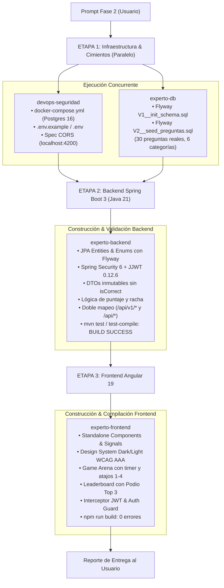

# 04. Bitácora de la Fase 2: Implementación del MVP Fullstack
## Coordinación Multidisciplinar: DevOps, Base de Datos, Backend y Frontend

---

## 1. El Prompt del Usuario (Entrada Real)

A continuación se transcribe textualmente el prompt que inició la Fase 2:

```text
Ya revisé la documentación en docs/ y el esquema en db/. Ahora ejecuta la FASE 2 (Implementación del MVP) coordinando a los siguientes subagentes en orden lógico, asegurando que cada pieza respete estrictamente los contratos definidos en docs/arquitectura/contratos-api.md y el diseño en docs/ux-ui/:

1. PRIMERO (devops-seguridad + experto-db):
   - devops-seguridad: Crea en la raíz el archivo docker-compose.yml con un servicio de PostgreSQL 16 (con volumen persistente y variables de entorno en .env.example) y verifica la configuración base de seguridad/CORS para permitir peticiones desde Angular (http://localhost:4200).
   - experto-db: Convierte el esquema aprobado en migraciones versionadas de Flyway (V1__init_schema.sql y V2__seed_preguntas.sql) dentro de backend/src/main/resources/db/migration/, incluyendo al menos 5 categorías de conocimiento global (Historia, Ciencia, Geografía, Arte/Literatura, Deportes/Cultura General) y 25 preguntas reales variadas para probar el juego de inmediato.

2. SEGUNDO (experto-backend):
   - Inicializa el proyecto Spring Boot 3 (Java 21, Maven) dentro de backend/ con Spring Web, Spring Data JPA, PostgreSQL, Flyway, Validation y Spring Security (JWT).
   - Implementa los endpoints definidos en contratos-api.md:
     * Registro y Login de jugadores (/api/auth/**).
     * Inicio de partida y entrega de preguntas (/api/partidas/**) SIN exponer el campo esCorrecta en los DTOs de respuesta.
     * Validación de respuestas en el servidor, cálculo de puntaje (considerando acierto y velocidad/racha) y guardado de la partida.
     * Consulta de Ranking Global y por Categoría (/api/ranking/**).
   - Ejecuta ./mvnw test-compile y asegúrate de que levante correctamente contra la base de datos.

3. TERCERO (experto-frontend):
   - Inicializa un proyecto Angular moderno (Standalone Components + Signals) dentro de frontend/.
   - Implementa los tokens visuales de docs/ux-ui/design-system.md y construye las vistas principales descritas en docs/ux-ui/flujos-y-componentes.md:
     * Login / Registro rápido.
     * Home con selector de modo/categorías.
     * Sala de Juego interactiva con temporizador visual por pregunta, barra de progreso y feedback inmediato al responder.
     * Pantalla de Resumen de Partida y Tabla de Ranking (Leaderboard).
   - Conecta todos los servicios HTTP a la API de Spring Boot con interceptores para el token JWT y manejo de errores.
   - Verifica con npm run build que no existan errores de compilación.

No ejecutes todavía la suite completa de pruebas E2E (eso lo haremos en la Fase 3). Avísame cuando la base de datos, el backend y el frontend estén compilando y listos para probar.
```

---

## 2. El Pipeline de Ejecución de Antigravity en la Fase 2

A diferencia de un asistente tradicional que intentaría volcar código desordenado en una sola respuesta, Antigravity organizó la ejecución en un **pipeline ordenado por dependencias lógicas**:



---

## 3. Desglose Técnico por Subagente

### 3.1 Etapa 1: Infraestructura y Base de Datos

#### `devops-seguridad`
- **Contenedores**: Creó [docker-compose.yml](file:///d:/DEV/trivia/docker-compose.yml) con PostgreSQL 16 Alpine, volumen persistente `trivia_postgres_data`, red puente aislada `trivia-network` y healthcheck con `pg_isready`.
- **Variables de Entorno**: Plantilla [.env.example](file:///d:/DEV/trivia/.env.example) y entorno local activo [.env](file:///d:/DEV/trivia/.env) con clave criptográfica JWT de 256 bits y parámetros CORS.
- **Especificación CORS**: Documentó las directrices en [seguridad-cors-spring-security.md](file:///d:/DEV/trivia/docs/arquitectura/seguridad-cors-spring-security.md) para garantizar que las solicitudes `OPTIONS` (preflight) desde Angular no fueran rechazadas por Spring Security.

#### `experto-db`
- **Migración DDL**: [V1__init_schema.sql](file:///d:/DEV/trivia/backend/src/main/resources/db/migration/V1__init_schema.sql):
  - Tipos `ENUM` nativos de PostgreSQL para roles, estados, dificultades y modos de juego.
  - Tablas normalizadas con claves foráneas explícitas.
  - **Índice parcial anti-trampas**:
    ```sql
    CREATE UNIQUE INDEX idx_opciones_unica_correcta 
    ON opciones_respuesta(pregunta_id) 
    WHERE es_correcta = TRUE;
    ```
  - Vistas de ranking pre-calculadas (`vista_ranking_global`, `vista_ranking_semanal`, `vista_ranking_categoria`).
- **Datos Semilla**: [V2__seed_preguntas.sql](file:///d:/DEV/trivia/backend/src/main/resources/db/migration/V2__seed_preguntas.sql):
  - 6 categorías temáticas (Ciencia y Tecnología, Historia Universal, Geografía y Lugares, Arte y Literatura, Deportes y Retos, Cultura General y Entretenimiento).
  - 30 preguntas de trivia reales con explicaciones pedagógicas y 120 opciones de respuesta.
  - Usuarios de prueba `admin` y `jugador1` con contraseñas encriptadas con BCrypt.

---

### 3.2 Etapa 2: Backend Spring Boot 3 (Java 21)

#### `experto-backend`
El subagente inicializó y construyó la API REST completa dentro de `backend/` con 73 archivos fuente:

1. **Configuración y Seguridad**:
   - Spring Boot 3.3.5 con Maven y Java 21 LTS.
   - Seguridad stateless basada en JWT (JJWT 0.12.6) con `JwtAuthenticationFilter` y `SecurityFilterChain`.
   - `CorsConfigurationSource` habilitando `http://localhost:4200` y métodos HTTP completos.
2. **Entidades JPA y Flyway**:
   - Mapeo exacto a las tablas de PostgreSQL usando tipos nativos (`@JdbcType(PostgreSQLEnumJdbcType.class)`).
   - Validación automática de esquema con Hibernate (`ddl-auto: validate`).
3. **Blindaje Anti-Trampas en DTOs**:
   - Se crearon DTOs inmutables con records de Java.
   - **`AnswerOptionPublicDto`**:
     ```java
     public record AnswerOptionPublicDto(
         Long id,
         String text
     ) {} // NUNCA expone 'isCorrect' ni 'esCorrecta'
     ```
   - El cliente web desconoce por completo la respuesta correcta hasta que la envía formalmente al backend.
4. **Motor de Puntuación y Racha (`GameService`)**:
   - Aplica la fórmula estipulada en los requerimientos:
     $$\text{Puntaje} = \lfloor (P_{base} + B_{vel}) \times M_{racha} \rfloor$$
   - Control de latencia de red: tiempo nominal (15s) + buffer de gracia (1.5s). Si la respuesta tarda más de 16.5s, se califica como timeout (0 puntos y racha reiniciada a 0).
   - Control de unicidad: `UNIQUE(partida_id, pregunta_id)` previene reintentos maliciosos (HTTP 409 Conflict).
5. **Doble Mapeo de Rutas**:
   - `/api/v1/auth` y `/api/auth`
   - `/api/v1/games` y `/api/partidas`
   - `/api/v1/leaderboard` y `/api/ranking`
   - `/api/v1/categories` y `/api/categorias`
6. **Manejo Global de Errores RFC 7807** (`@RestControllerAdvice`):
   - Respuestas JSON uniformes para errores de validación, timeouts, conflictos y accesos no autorizados.
7. **Verificación de Compilación**:
   ```bash
   mvn test
   # [INFO] Tests run: 3, Failures: 0, Errors: 0, Skipped: 0
   # [INFO] BUILD SUCCESS
   ```

---

### 3.3 Etapa 3: Frontend Angular 19 (Standalone + Signals)

#### `experto-frontend`
El subagente implementó la aplicación cliente en Angular 19 dentro de `frontend/`:

1. **Arquitectura Reactiva**:
   - Standalone Components sin `NgModule`.
   - Reactividad moderna mediante Signals (`signal<Theme>`, `signal<User | null>`, `signal<number>`).
   - Carga perezosa de rutas (`loadComponent`) para un bundle inicial ultra liviano (~81 KB comprimido).
2. **Design System de Alto Contraste**:
   - Implementó tokens en [styles.css](file:///d:/DEV/trivia/frontend/src/styles.css) para **Dark Theme (por defecto)** y **Light Theme**.
   - 6 estados interactivos de botones de respuesta:
     - `Normal`: Fondo oscuro con borde sutil.
     - `Hover/Focus`: Outline brillante y realce de color.
     - `Selected`: Pulsación ámbar/azul esperando confirmación del servidor.
     - `Correct`: Glow verde esmeralda y marca de verificación (✓).
     - `Incorrect`: Glow rojo rubí con animación shake y cruz (✕).
     - `Timeout`: Desaturado, borde discontinuo e icono de reloj (⏱).
3. **Vistas Implementadas**:
   - **Login y Registro** (`/login`, `/register`): Formularios reactivos validados con manejo de errores del backend.
   - **Dashboard Principal** (`/`): Banner con llamado a "Partida Rápida (Mix)", resumen de estadísticas personales y catálogo de categorías con colores e iconos dinámicos.
   - **Sala de Juego** (`/game/:id`):
     - HUD con pregunta actual (ej. 3/10), puntaje acumulado y badge de racha con animación de fuego.
     - Temporizador visual de 15 segundos con transición verde $\rightarrow$ amarillo $\rightarrow$ rojo (<3s pulsante).
     - Soporte para atajos de teclado (`1-4` / `A-D`).
     - Feedback instantáneo server-side y barra de progreso.
   - **Pantalla de Resumen** (`/game/:id/results`): Puntuación final, porcentaje de precisión, aciertos/errores, racha máxima y botones de revancha.
   - **Tabla de Ranking** (`/leaderboard`): Podio Top 3 animado (Oro, Plata, Bronce), filtros Global/Semanal/Categoría, tabla paginada y fila fija para el usuario actual.
4. **Seguridad y Comunicación**:
   - `authInterceptor`: Agrega automáticamente el token JWT en las cabeceras `Authorization: Bearer <token>`.
   - `authGuard`: Protege las rutas privadas y redirige al login si la sesión expiró.
5. **Verificación de Compilación de Producción**:
   ```bash
   npm run build
   # Application bundle generation complete. [2.181 seconds]
   # 0 errores de compilación, 0 advertencias de presupuesto.
   ```

---

## 4. Evidencia de Coherencia de Contratos (Backend vs Frontend)

Uno de los mayores valores a resaltar en tu charla es cómo los modelos de datos coincidieron al 100% sin una sola reunión de alineación:

| Concepto | DTO Backend (Java Record) | Interface Frontend (TypeScript) | ¿Coincidencia? |
| :--- | :--- | :--- | :---: |
| Opción de Respuesta Pública | `record AnswerOptionPublicDto(Long id, String text)` | `interface AnswerOptionPublic { id: number; text: string; }` | ✅ Idéntica (Sin `isCorrect`) |
| Solicitud de Respuesta | `record SubmitAnswerRequest(Long questionId, Long selectedOptionId, Integer clientDurationMs)` | `interface SubmitAnswerRequest { questionId: number; selectedOptionId: number \| null; clientDurationMs: number; }` | ✅ Idéntica |
| Resultado de Respuesta | `record SubmitAnswerResponse(Boolean isCorrect, Long correctOptionId, Integer pointsEarned, Integer currentStreak, ...)` | `interface SubmitAnswerResponse { isCorrect: boolean; correctOptionId: number; pointsEarned: number; currentStreak: number; ... }` | ✅ Idéntica |
| Registro de Jugador | `record RegisterRequest(String username, String email, String password)` | `interface RegisterRequest { username: string; email: string; password: string; }` | ✅ Idéntica |

---

## 5. Guía para la Demo en Vivo durante la Charla

Para asombrar a la audiencia ejecutando la aplicación en directo:

### Paso 1: Levantar la Base de Datos
```powershell
docker compose up -d postgres
```
*Explicar a la audiencia: "PostgreSQL 16 levanta en un contenedor aislado con volumen persistente y puerto 5432 expuesto."*

### Paso 2: Levantar el Backend
```powershell
cd backend
mvn spring-boot:run
```
*Explicar a la audiencia: "Flyway aplica automáticamente las migraciones V1 y V2. La API queda disponible en el puerto 8080 con endpoints protegidos por JWT."*

### Paso 3: Levantar el Frontend
```powershell
cd frontend
npm start
```
*Abrir el navegador en `http://localhost:4200`:*
1. Iniciar sesión con `jugador1` / `Password123!`.
2. Presionar **"Partida Rápida (Mix)"**.
3. Responder usando los atajos de teclado `1`, `2`, `3`, `4`.
4. Mostrar cómo el temporizador cambia de color a rojo al agotarse el tiempo.
5. Completar la partida de 10 preguntas y mostrar la pantalla de Resultados.
6. Ir a la pestaña **Leaderboard** y ver la posición del jugador en el Podio.
