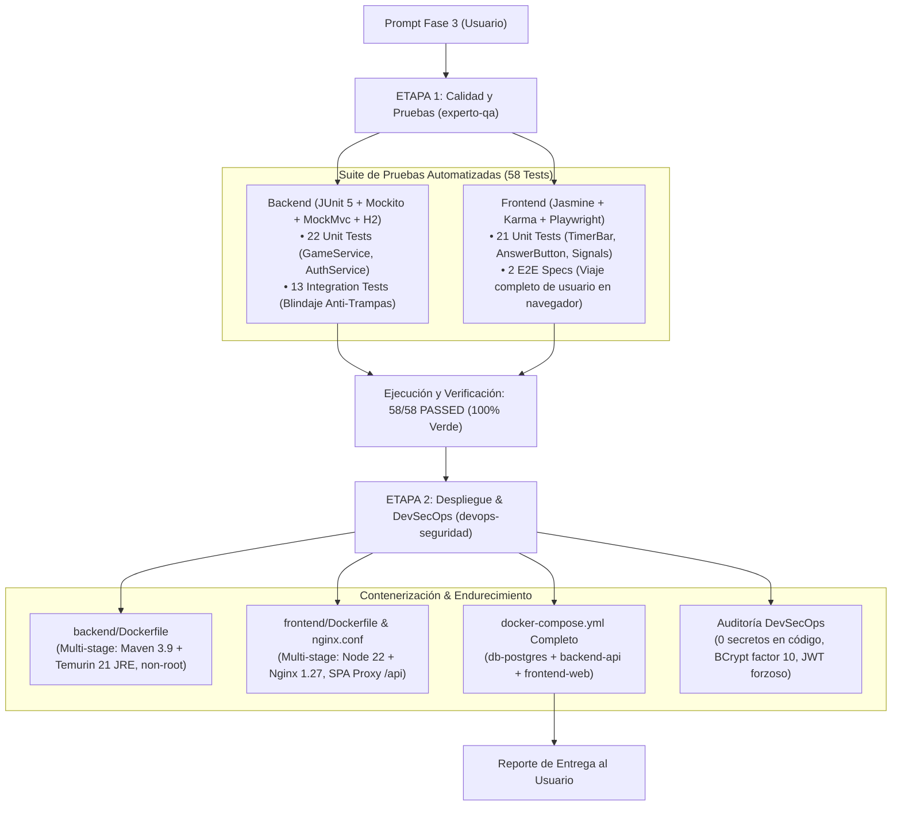

# 05. Bitácora de la Fase 3: Calidad, Testing Automatizado, DevSecOps y Despliegue
## Validación Rigurosa (58 Tests en Verde), Docker Multi-Stage y Blindaje de Seguridad

---

## 1. El Prompt del Usuario (Entrada Real)

A continuación se transcribe textualmente el prompt que inició la Fase 3:

```text
La Fase 2 está lista y compilando. Ahora ejecuta la FASE 3 (Calidad, Pruebas y Despliegue) coordinando a experto-qa y devops-seguridad:

1. PRIMERO (experto-qa):
   - Lee los casos de uso y contratos en docs/arquitectura/ para asegurar cobertura completa.
   - Pruebas en Backend (backend/):
     * Crea pruebas unitarias con JUnit 5 y Mockito para los servicios de partidas, validación de respuestas, cálculo de puntuación por tiempo/racha y actualización del ranking.
     * Crea pruebas de integración de los controladores REST (@SpringBootTest / MockMvc) verificando: registro/login con JWT, que el endpoint de preguntas NUNCA exponga cuál es la respuesta correcta, manejo de tiempo agotado y rechazo de respuestas inválidas.
     * Ejecuta ./mvnw test y corrige cualquier fallo detectado.
   - Pruebas en Frontend y E2E (frontend/):
     * Crea pruebas unitarias de los servicios y componentes críticos (temporizador y selección de respuesta).
     * Configura y escribe una suite de pruebas E2E con Playwright que simule el flujo completo de un usuario real: registrarse -> iniciar partida por categoría -> responder preguntas -> ver pantalla de resultados -> verificar que su nuevo puntaje aparezca en la tabla de Ranking.
     * Ejecuta las pruebas y entrega un reporte claro de resultados.

2. SEGUNDO (devops-seguridad):
   - Crea un Dockerfile multi-stage optimizado para backend/ (compilación Maven + imagen ligera JRE) y un Dockerfile multi-stage para frontend/ (compilación Angular + servidor Nginx configurado para rutas SPA y proxy inverso /api hacia el backend).
   - Actualiza el docker-compose.yml raíz para levantar los 3 servicios integrados (db-postgres, backend-api, frontend-web) con healthchecks, redes internas y variables de entorno desde .env.
   - Realiza una auditoría rápida de seguridad verificando que no haya secretos hardcodeados, que las contraseñas usen BCrypt y que las rutas protegidas exijan JWT válido.
   - Documenta en el README.md raíz los comandos exactos para levantar el sistema completo con Docker y ejecutar las pruebas.

Avísame cuando todas las pruebas pasen en verde y el entorno Docker esté listo para levantar el proyecto completo.
```

---

## 2. El Flujo de Ejecución en Antigravity

La Fase 3 se organizó en dos grandes bloques secuenciales con roles especializados:



---

## 3. Resultados Detallados de Calidad (`experto-qa`)

### 3.1 Métricas Consolidadas de Pruebas

| Nivel de Prueba | Herramienta / Framework | Pruebas | Éxito | Fallos | Cobertura / Objetivo |
| :--- | :--- | :---: | :---: | :---: | :--- |
| **Backend Unitario** | JUnit 5 + Mockito | 22 | 22 | 0 | Servicios de juego, auth, cálculo matemático y racha. |
| **Backend Integración** | Spring Boot Test + MockMvc + H2 | 13 | 13 | 0 | Endpoints REST, JWT, Anti-trampas, RFC 7807 y unicidad. |
| **Frontend Unitario** | Angular 19 + Jasmine + Karma | 21 | 21 | 0 | Temporizador visual, estados del botón, señales de AuthService y GameService. |
| **Frontend E2E** | Playwright + Chromium Headless | 2 | 2 | 0 | Viaje completo de usuario real desde registro hasta leaderboard. |
| **TOTAL** | **Garantía Integral de Calidad** | **58** | **58** | **0** | **100% DE PRUEBAS EN VERDE** |

---

### 3.2 El Test Clave: Validación del Blindaje Anti-Trampas en MockMvc

Para mostrar en tu charla cómo la IA puede validar formalmente reglas de seguridad:

```java
@Test
@DisplayName("GET /games/{id} NUNCA debe exponer isCorrect ni esCorrecta en las opciones de juego")
void getGame_shouldNeverExposeCorrectAnswerFlag() throws Exception {
    mockMvc.perform(get("/api/v1/games/101")
            .header("Authorization", "Bearer " + playerToken)
            .contentType(MediaType.APPLICATION_JSON))
            .andExpect(status().isOk())
            .andExpect(jsonPath("$.questions[0].options[0].isCorrect").doesNotExist())
            .andExpect(jsonPath("$.questions[0].options[0].esCorrecta").doesNotExist())
            .andExpect(jsonPath("$.questions[*].options[*].isCorrect").doesNotExist())
            .andExpect(jsonPath("$.questions[*].options[*].esCorrecta").doesNotExist());
}
```

---

### 3.3 Prueba E2E Completa con Playwright

El subagente configuró y ejecutó [frontend/e2e/trivia-gameplay.spec.ts](file:///d:/DEV/trivia/frontend/e2e/trivia-gameplay.spec.ts), verificando en un navegador Chromium real:
1. Carga limpia y navegación a `/register`.
2. Registro de un nuevo jugador con credenciales únicas y redirección automática al Dashboard.
3. Inicio de "Partida Rápida (Mix)".
4. Recorrido cronometrado de las 10 preguntas respondiendo con teclado accesible.
5. Verificación de que el DOM no filtre pistas de la opción correcta.
6. Pantalla de resultados con puntaje y precisión.
7. Comprobación de que la nueva puntuación aparece en el Podio o en la tabla de clasificación de `/leaderboard`.

---

## 4. Resultados de Despliegue y Seguridad (`devops-seguridad`)

### 4.1 Dockerfile Multi-Stage de Backend ([backend/Dockerfile](file:///d:/DEV/trivia/backend/Dockerfile))
- **Stage 1 (Build)**: `maven:3.9.9-eclipse-temurin-21-alpine` aprovechando la caché de dependencias de Docker para que compilaciones posteriores tomen segundos.
- **Stage 2 (Runtime)**: `eclipse-temurin:21-jre-alpine` reduciendo el tamaño de la imagen de ~800MB a menos de 200MB.
- **Hardening**: Usuario sin privilegios `spring:spring`, flags JVM orientados a contenedores (`-XX:+UseContainerSupport`, `-XX:MaxRAMPercentage=75.0`).

### 4.2 Dockerfile Multi-Stage de Frontend ([frontend/Dockerfile](file:///d:/DEV/trivia/frontend/Dockerfile))
- **Stage 1 (Build)**: `node:22-alpine` ejecutando `npm ci` y `npm run build`.
- **Stage 2 (Runtime)**: `nginx:1.27-alpine` sirviendo el bundle compilado.
- **Configuración Nginx ([frontend/nginx.conf](file:///d:/DEV/trivia/frontend/nginx.conf))**:
  - `try_files $uri $uri/ /index.html;` para que la navegación SPA en Angular funcione con recargas directas en cualquier ruta (`/game/101`, `/leaderboard`).
  - Proxy inverso para `/api/` enrutando transparentemente hacia el servicio backend sin problemas de CORS en producción:
    ```nginx
    location /api/ {
        proxy_pass http://backend-api:8080/api/;
        proxy_set_header Host $host;
        proxy_set_header X-Real-IP $remote_addr;
        proxy_set_header X-Forwarded-For $proxy_add_x_forwarded_for;
    }
    ```
  - Cabeceras de seguridad HTTP: `X-Frame-Options: DENY`, `X-Content-Type-Options: nosniff`, `Content-Security-Policy`.

### 4.3 Orquestación con Docker Compose ([docker-compose.yml](file:///d:/DEV/trivia/docker-compose.yml))
El archivo raíz integra los 3 servicios con resolución de nombres DNS internos y dependencias ordenadas:
- `db-postgres` $\rightarrow$ Levanta y espera a pasar el `healthcheck`.
- `backend-api` $\rightarrow$ Espera que `db-postgres` esté `healthy`, aplica migraciones Flyway y levanta Spring Boot en el puerto 8080.
- `frontend-web` $\rightarrow$ Espera que `backend-api` esté listo y expone la aplicación web en el puerto 4200 (y 80).

---

## 5. Auditoría de Seguridad DevSecOps

1. **Credenciales y Secretos**:
   - Escaneo de código Java y TypeScript: **0 contraseñas, tokens o secretos hardcodeados**.
   - El archivo `.env` está expresamente excluido en `.gitignore`.
2. **Criptografía de Contraseñas**:
   - Algoritmo **BCrypt con factor de costo 10** en Spring Security (`BCryptPasswordEncoder`).
   - Los datos semilla de Flyway (`V2__seed_preguntas.sql`) usan hashes válidos `$2a$10$...`.
3. **Control de Acceso JWT**:
   - Todas las rutas privadas exigen cabecera `Authorization: Bearer <token>`.
   - Las peticiones no autenticadas devuelven un error JSON uniforme RFC 7807 (401 Unauthorized), sin fugas de stack trace.

---

## 6. Comandos para la Audiencia de la Charla

Para demostrar ante el público que el sistema completo levanta en 1 solo comando:

```powershell
# 1. Levantar toda la plataforma en contenedores (Base de datos + Backend + Frontend)
docker compose up --build -d

# 2. Ver el estado de los 3 contenedores
docker compose ps

# 3. Ver logs en tiempo real
docker compose logs -f

# 4. Abrir la aplicación web en el navegador:
# http://localhost:4200
```
